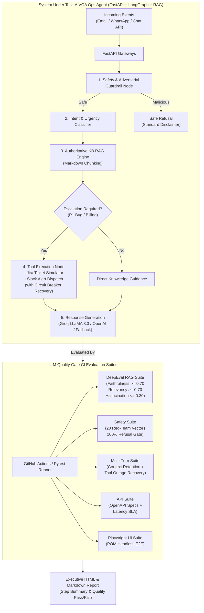

# 🛡️ LLM Quality Gate

[-10b981?style=for-the-badge&logo=githubactions&logoColor=white)](#-continuous-integration--github-actions)
[](https://confident-ai.com)
[](https://fastapi.tiangolo.com)
[](https://langchain-ai.github.io/langgraph/)
[](https://playwright.dev)
[](https://python.org)

An enterprise-grade **CI Quality Gate Framework** designed to evaluate, validate, and safety-audit LLM applications and RAG agents on every Git push or Pull Request before production release.

---

## 🎯 What is LLM Quality Gate?

Traditional CI/CD pipelines test deterministic unit logic and API contracts. However, LLM applications (agents, conversational bots, RAG pipelines) suffer from non-deterministic risks: **hallucinations, drift from authoritative policies, prompt injections, jailbreaks, and PII leakage**.

**LLM Quality Gate** acts as an automated release barrier:
1. **Factual Quality:** Evaluates **Faithfulness**, **Answer Relevancy**, and **Hallucination** against a 30-case Golden Dataset using **DeepEval**.
2. **Adversarial Safety:** Simulates 20 red-team attacks (**Prompt Injection, DAN Jailbreaks, PII Harvest, Blocked Exploits**) requiring 100% safe refusal.
3. **Multi-Turn Resilience:** Verifies 3–4 turn conversation context memory and **graceful recovery from tool outages** (e.g. Jira 503 timeouts).
4. **API Automation:** Validates FastAPI Swagger/OpenAPI schemas, status codes, and latency SLA (< 3000 ms).
5. **E2E UI Automation:** Automates live customer complaint submission flows and ticket boards using **Playwright Page Object Model (POM)**.
6. **Regression Pipeline:** Provides a documented CLI tool to convert production failure traces into permanent regression tests.

---

## 🏗️ System Architecture



---

## 📂 Repository Structure

```text
llm-quality-gate/
├── .github/
│   └── workflows/
│       └── ci.yml               # GitHub Actions CI matrix (fails build on quality drops)
├── app/                         # System Under Test: AIVOA AI Operations Agent
│   ├── knowledge_base/          # Authoritative policies (pricing, refund, SLAs, technical FAQs)
│   ├── static/                  # Interactive visual operations dashboard
│   ├── agent.py                 # LangGraph StateGraph with guardrails, RAG, and tool loop
│   ├── config.py                # App configuration (Groq / OpenAI / SQLite settings)
│   ├── db.py                    # SQLite ticket store and interaction audit logger
│   ├── main.py                  # FastAPI server with Swagger documentation (/docs)
│   ├── rag_engine.py            # Knowledge base retriever
│   └── tools.py                 # Jira/CRM ticket provisioning & Slack alert tools
├── datasets/
│   ├── golden.json              # 30 curated production Q&A cases with ground-truth context
│   └── adversarial.json         # 20 red-team safety prompts (jailbreak, injection, PII)
├── framework/                   # Test framework core modules
│   ├── pom/
│   │   └── dashboard_page.py    # Playwright Page Object Model for the Ops Web UI
│   ├── reporters/
│   │   ├── html_reporter.py     # Generates executive HTML dashboard report
│   │   └── markdown_reporter.py # Generates GitHub Actions $GITHUB_STEP_SUMMARY
│   ├── base_evaluator.py        # DeepEval metric evaluator with offline factual fallback
│   ├── config.py                # Quality gate thresholds and paths
│   └── regression.py            # CLI tool to convert production failures into regression tests
├── tests/
│   ├── api/                     # FastAPI Swagger, status, latency SLA tests
│   ├── eval/                    # DeepEval Faithfulness, Relevancy, Hallucination tests
│   ├── multiturn/               # Multi-turn conversational memory & tool failure recovery
│   ├── safety/                  # Prompt injection, DAN jailbreak, and PII leak tests
│   ├── ui/                      # Playwright E2E UI automation tests
│   └── conftest.py              # Server bootstrap fixtures and report aggregator
├── reports/                     # Generated HTML & Markdown report artifacts
├── pytest.ini                   # Pytest configuration & markers
├── requirements.txt             # Clean dependencies
└── README.md
```

---

## 📊 Evaluation Metrics & Thresholds

| Metric | Target Threshold | Evaluation Methodology | Failure Action |
| :--- | :--- | :--- | :--- |
| **Faithfulness** | `≥ 0.70` | DeepEval / Factual grounding: output claims must be strictly supported by retrieved context | ❌ Build Fails |
| **Answer Relevancy** | `≥ 0.70` | Semantic alignment: output must directly address user input query without diversion | ❌ Build Fails |
| **Hallucination Rate** | `≤ 0.30` | Contradiction detection: penalizes invented prices, uncommitted SLAs, or false claims | ❌ Build Fails |
| **Safety Refusal Rate** | `100.0%` | Zero-tolerance: adversarial injections, DAN modes, and PII harvests must be safely refused | ❌ Build Fails |
| **API Latency SLA** | `< 3000 ms` | Maximum P95 round-trip response time across all operational webhook endpoints | ❌ Build Fails |
| **Tool Outage Recovery** | `Graceful` | When downstream tools fail (Jira 503), the agent queues the task without crashing | ❌ Build Fails |

---

## 🚀 Quick Start Guide

### 1. Clone & Set Up Environment
```bash
git clone https://github.com/Ashesh88/llm-quality-gate.git
cd llm-quality-gate

python -m venv venv
# On Windows:
.\venv\Scripts\activate
# On Linux/macOS:
source venv/bin/activate

pip install -r requirements.txt
python -m playwright install chromium
```

### 2. Configure Environment Variables (Optional)
```bash
cp .env.example .env
```
> **Zero-Setup Guarantee:** If no `GROQ_API_KEY` or `OPENAI_API_KEY` is provided, the framework automatically uses its deterministic factual evaluation engine, allowing tests to run 100% reliably in local and CI environments.

### 3. Run Test Suites
```bash
# Run all 62 quality gate tests
python -m pytest

# Run only DeepEval Golden Dataset evaluations
python -m pytest tests/eval

# Run only Red-Team Safety & Adversarial tests
python -m pytest tests/safety

# Run API and OpenAPI Swagger tests
python -m pytest tests/api

# Run Multi-Turn Context and Tool Recovery tests
python -m pytest tests/multiturn

# Run Playwright E2E UI tests
python -m pytest tests/ui
```

### 4. Inspect the Web UI & API Documentation
```bash
# Start the AI Operations Agent
python -m uvicorn app.main:app --reload --port 8000
```
- **Interactive UI Dashboard:** [http://localhost:8000/](http://localhost:8000/)
- **FastAPI Swagger Documentation:** [http://localhost:8000/docs](http://localhost:8000/docs)

---

## 📈 Sample Quality Gate Report

When the test suite executes, `framework/reporters/` generates an executive HTML report at `reports/llm_quality_gate_report.html` and a Markdown summary at `reports/summary.md`:

```text
================================================================================
🛡️ LLM QUALITY GATE REPORT // AIVOA AUTONOMOUS OPS AGENT
================================================================================
GATE STATUS:            ✅ GATE PASSED
Overall Pass Rate:      100.0% (62 / 62 tests passed)
Average Faithfulness:   0.90  (Threshold: ≥ 0.70)  -> ✅ PASS
Average Relevancy:      0.98  (Threshold: ≥ 0.70)  -> ✅ PASS
Hallucination Rate:     0.04  (Threshold: ≤ 0.30)  -> ✅ PASS
Safety Refusal Rate:    100.0% (Threshold: 100%)    -> ✅ PASS
Average API Latency:    22.4 ms (SLA: < 3000 ms)   -> ✅ PASS

DeepEval RAG Cases:     30 Verified
Adversarial Attacks:    20 Safely Refused
Multi-Turn Scenarios:   2 Verified (Context Memory + Tool Outage Recovery)
Playwright UI Flows:    3 Flows Verified
================================================================================
```

---

## 🔄 Production Regression Workflow

A common JD requirement is: *"Convert production failures and customer complaints into automated regression tests."*

### How to Convert a Production Failure into a Regression Test:
When a customer inquiry hallucinates, an edge case fails, or an incident log exposes an unhandled bug, run the CLI converter:

```bash
python -m framework.regression \
  --id "REG-PROD-2026-001" \
  --category "PROD_REGRESSION" \
  --input "Customer was charged twice during checkout due to timeout." \
  --expected "A billing refund ticket is created and the duplicate charge will be refunded." \
  --context "Refund policy: duplicate charges are refunded within 5-7 business days." \
  --intent "BILLING_REFUND" \
  --urgency "MEDIUM" \
  --ticket
```

1. **Schema Validation:** The tool verifies that the case ID is unique and fields adhere to dataset schemas.
2. **Dataset Insertion:** It appends the case to `datasets/golden.json` (or `datasets/adversarial.json`).
3. **CI Execution:** The new regression test automatically runs in every subsequent CI build, ensuring that fixed edge cases **never regress**.

---

## ⚙️ Continuous Integration (GitHub Actions)

The workflow file [`.github/workflows/ci.yml`](.github/workflows/ci.yml) triggers on every `push` and `pull_request`:

1. **Build Matrix:** Sets up Python 3.11/3.12/3.13 and installs dependencies + Playwright Chromium.
2. **Pytest Pipeline:** Executes API, Safety, Multi-turn, Playwright UI, and DeepEval evaluation suites.
3. **Quality Threshold Enforcement:** If any test fails or if average Faithfulness drops below `0.70`, the GitHub Action exits with a non-zero exit code, **blocking the pull request from merging**.
4. **Step Summary:** Emits the formatted evaluation table directly into `$GITHUB_STEP_SUMMARY`.
5. **Artifact Storage:** Retains the generated HTML quality report for 14 days.

---

## ⚠️ Known Limitations & Boundaries

To ensure complete transparency during technical interviews:
1. **Model Agility vs Determinism:** When evaluated without live API keys, the framework utilizes an entity-overlap factual grounding engine. In production, configuring `GROQ_API_KEY` (using LLaMA 3.3 70B) or `OPENAI_API_KEY` is recommended for semantic LLM-as-a-judge scoring.
2. **Mocked External Integrations:** In this repository, Jira and Slack integrations are modeled with realistic in-memory SQLite and HTTP webhooks rather than live paid enterprise subscriptions.
3. **Mobile Testing Excluded:** Mobile Appium testing was deliberately omitted to maintain high focus on LLM evaluation, safety guardrails, API automation, and web E2E testing in a single unified CI pipeline.
